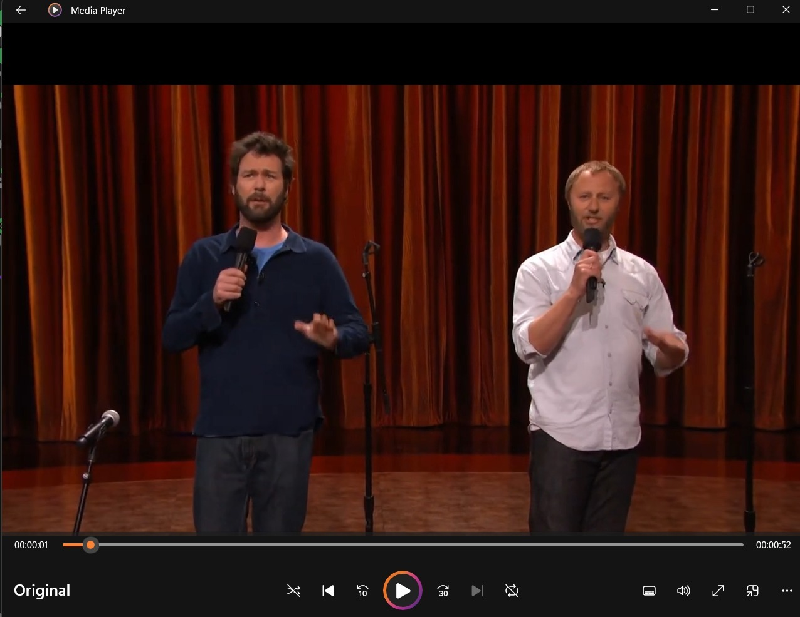
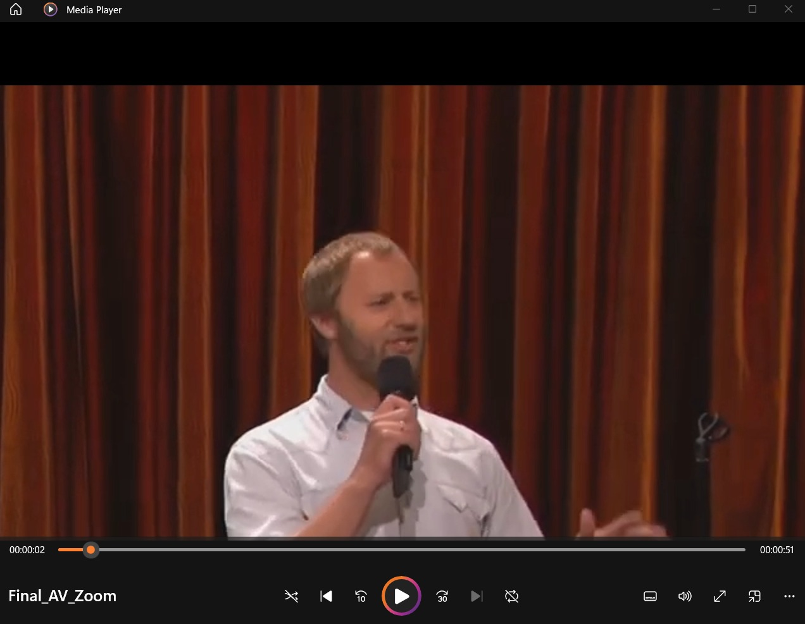
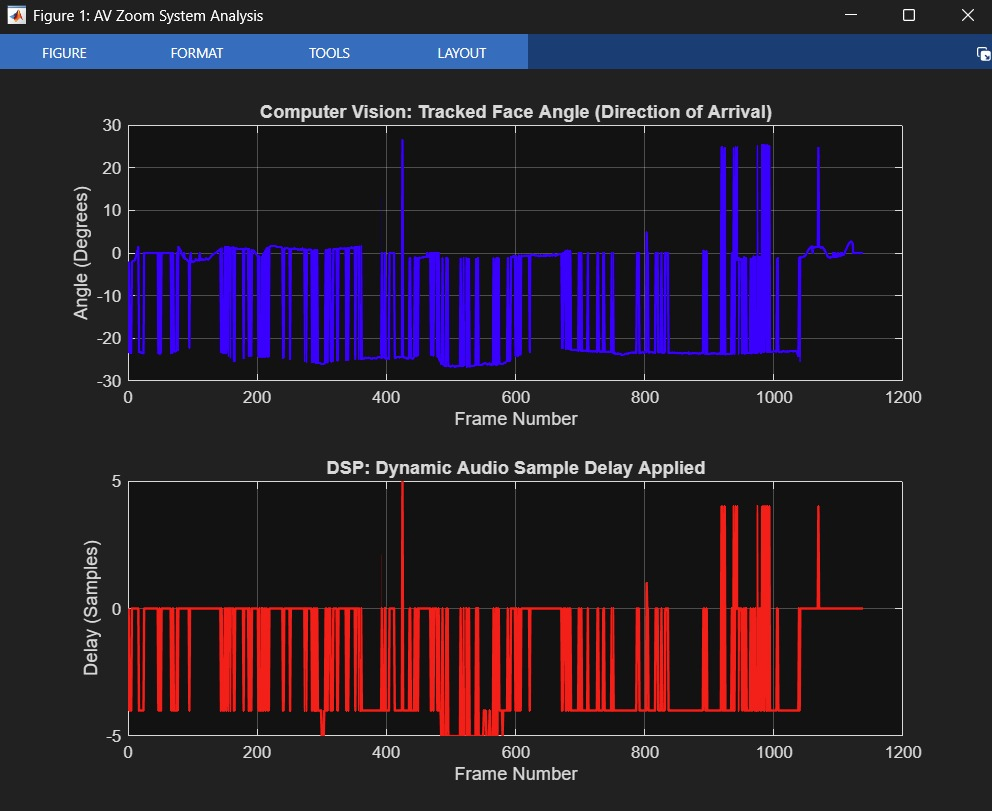

# Synchronizing Real-Time Face Tracking with Directional Audio Filtering

An Audio-Visual Zoom (AV Zoom) experiment in MATLAB. A face detector tracks the speaker in each video frame. The face position is turned into a direction-of-arrival angle, and that angle sets a sample delay for a two-channel delay-and-sum beamformer on the stereo audio. The video is cropped and zoomed around the tracked face, and the processed video and audio are written to one AVI file.

## How it works

1. Load an `.mp4` with a stereo audio track and split the audio into one chunk per video frame.
2. Detect a face in each frame with `vision.CascadeObjectDetector`.
3. Map the face centre to an angle using the camera field of view (70 degrees).
4. Convert the angle to a time difference of arrival for a 0.08 m microphone spacing, then to an integer sample delay.
5. Shift one channel by that delay and average the two channels (delay-and-sum).
6. Crop the frame around the face, resize it to the original resolution, and write video and audio to an `.avi` with `vision.VideoFileWriter`.
7. Plot the tracked angle and the applied sample delay per frame.

The program processes a prerecorded video frame by frame. The plots show the computed steering angle and the applied integer sample delay.

## Files

- `av_zoom.m` - MATLAB program
- `original_frame.jpg`, `output_frame.jpg`, `analysis_plots.jpg` - original frame, zoomed output frame, and angle/delay analysis plots

## Requirements

MATLAB with the Computer Vision Toolbox, and an input `.mp4` that has a two-channel audio track. Edit `inputFile` and `outputFile` at the top of `av_zoom.m`.

## Output

| Original frame | Zoomed output frame |
|---|---|
|  |  |

## Demo video

The full processed output video and the original input clip are shared on Google Drive: [AV Zoom video folder](https://drive.google.com/drive/folders/1K8dhx959kbSkAFphkaI2dwaUmXYTZDiO?usp=sharing)

- `Final_AV_Zoom.avi` (~2.1 GB) - processed output with the face-tracking zoom and directional audio
- `Original.mp4` - original input clip
